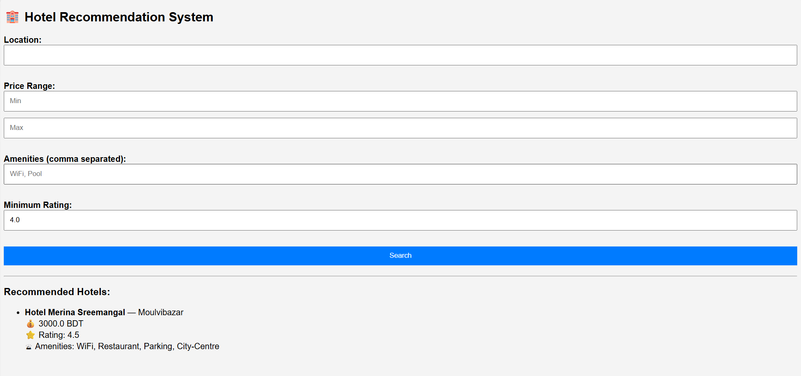

# 🏨 Hotel Recommendation System

A small Flask web app that recommends hotels from a 56-property dataset, filtered by location, price range, amenities, and minimum user rating.



## Quick start

Requires Python 3.13+ (developed on 3.13), Flask, and pandas:

```bash
pip install flask pandas
python app.py
```

Then open **http://127.0.0.1:5000/**.

> **Run from the repo root.** The app loads `model.pkl` with a relative path, so starting it from any other directory fails.

`python app.py` is the only supported way to launch it — the Flask CLI (`flask --app app run`) and `import app` crash when loading the pickle (see [AGENTS.md](AGENTS.md)).

## Search form

| Field | Notes |
|---|---|
| Location | Case-insensitive partial match (e.g. `Moulvibazar`, `Cox`) |
| Price range | Min/max per night in BDT |
| Amenities | Comma separated, all must match (e.g. `WiFi, Pool`) |
| Minimum rating | 0–5, e.g. `4.0` |

Results are sorted by user rating (desc), then price (asc), top 5.

## JSON API

```bash
curl -X POST http://127.0.0.1:5000/api/recommend \
  -H "Content-Type: application/json" \
  -d '{"location":"Moulvibazar","budget":[0,50000],"amenities":["Pool"],"rating":4.0,"top_n":2}'
```

Returns a JSON array of hotels. Malformed `budget` / `rating` / `top_n` returns HTTP 400 with `{"error": ...}`.

## Project structure

```
app.py                   Flask app: routes "/" (form) and "/api/recommend" (JSON)
hotel_recommendation.py  recommend_hotels() — the filtering/sorting logic
hotels.csv               Raw dataset (56 rows, 12 columns)
model.pkl                Pickled processed DataFrame (not a trained model)
hotel_data.ipynb         EDA notebook; its last cell regenerates model.pkl
templates/, static/      Jinja template and CSS
docs/screenshot.png      Screenshot above
```

### How data flows

`hotels.csv` → `hotel_data.ipynb` (impute missing values, encode categories) → `model.pkl` → loaded once at startup by `app.py` → `recommend_hotels()` filters and sorts it per request.

**If you change `hotels.csv`, regenerate `model.pkl`** by running the notebook top-to-bottom (last cell writes it). See [AGENTS.md](AGENTS.md) for the pandas 3 gotcha in that notebook.

## Documentation

- [AGENTS.md](AGENTS.md) — developer/agent notes: entrypoint constraints, pickle quirks, verification steps.
